# ComfyUI CharacterPose **v2**

**One sprite in. A full pose library out — same face, same tunic, same art style.**

Turn a single 2D character into RPG-ready animation frames with [Flux.2 Klein](https://github.com/comfyanonymous/ComfyUI) and a Mixamo-powered OpenPose library. No re-drawing. No style drift.

[](LICENSE)
[](https://github.com/comfyanonymous/ComfyUI)
[](https://www.python.org/)

---

## One character. Many poses. Same look.

<p align="center">
  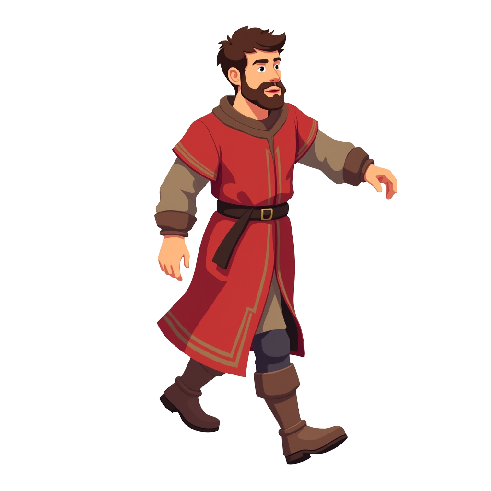
  <br/>
  <em>Source sprite — the identity lock for every generation below</em>
</p>

### Head Hit — left profile

| Pose guide | Guide on sprite | Final frames |
|:---:|:---:|:---:|
| 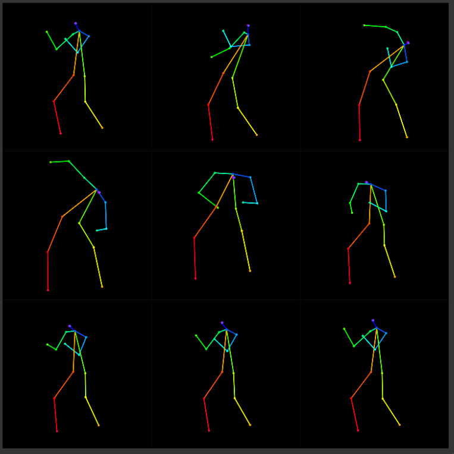 |  | 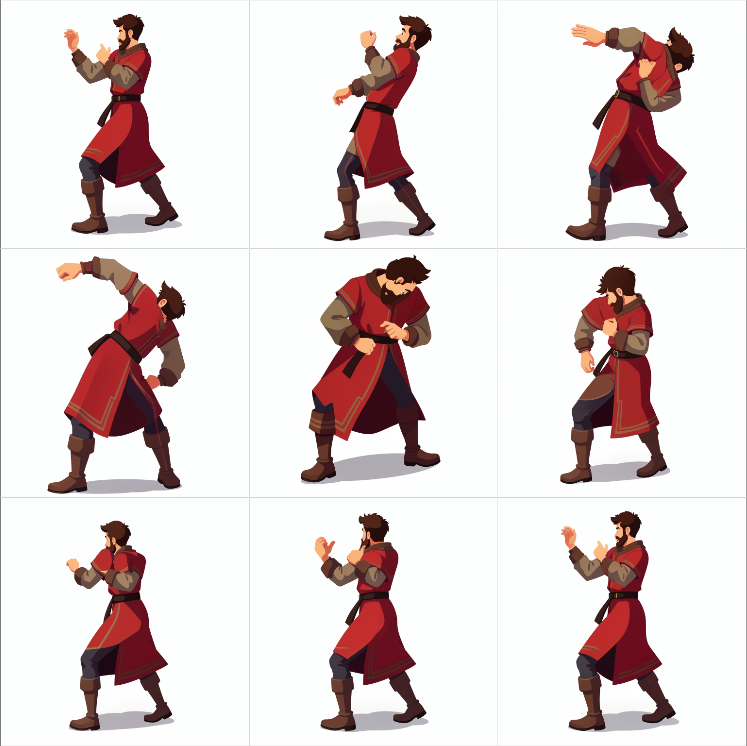 |

### Head Hit — right profile

| Pose guide | Guide on sprite | Final frames |
|:---:|:---:|:---:|
| 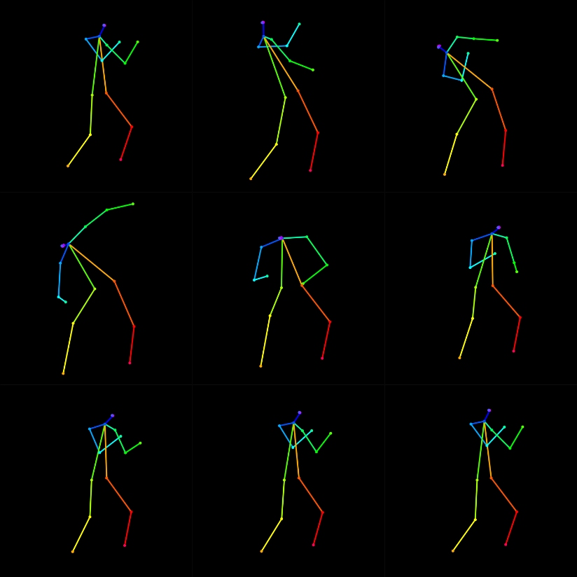 | 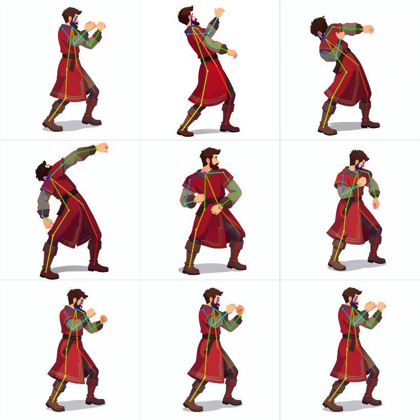 | 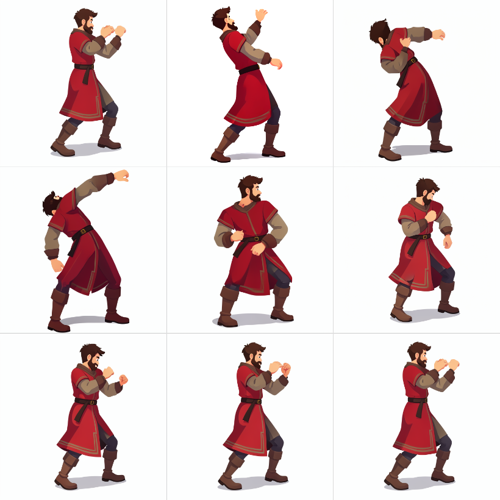 |

### Slow Run — left profile

| Pose guide | Guide on sprite | Final frames |
|:---:|:---:|:---:|
| 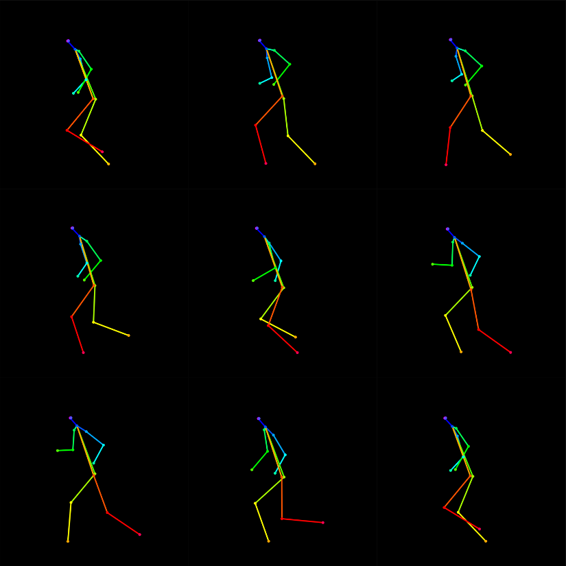 | 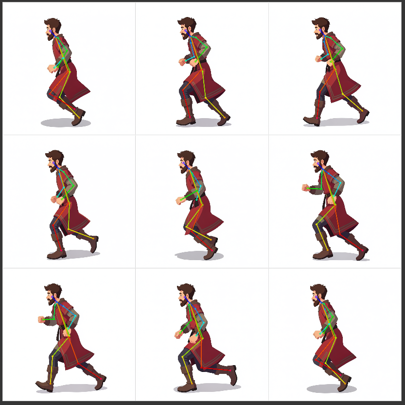 | 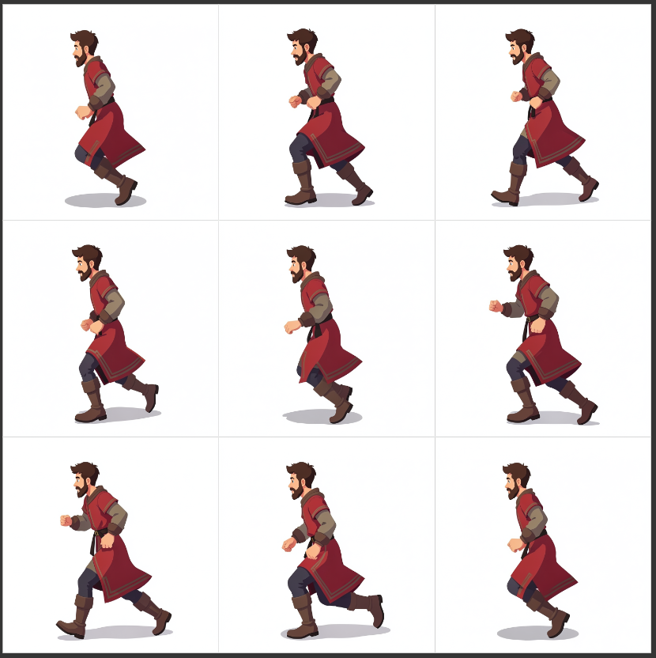 |

---

## Why CharacterPose?

### Style that sticks

Prep auto-captions the sprite (Florence-2 when available), injects a **COLOR LOCK** palette, and builds per-pose edit prompts. Klein then regenerates each frame from that identity — red tunic, gold trim, beard, line weight — not a random reinterpretation.

### Mixamo & FBX → 2D skeleton library

<p>
  <a href="https://www.mixamo.com/"></a>
  &nbsp;
  
</p>

Import animations from **[Mixamo](https://www.mixamo.com/)** (or any Mixamo-compatible **`.fbx`** rig) and project them into OpenPose COCO-18 **`.pose`** files. One download → a reusable 2D pose library for every character you own.

### Camera packs: 4 / 6 / 8 views

| Mode | Views | Best for |
|------|--------|----------|
| **`4_iso`** | SE · SO · NE · NO | Classic isometric / RTS sheets |
| **`6`** | 4 ISO + TOP + BOT | ISO + front / back |
| **`8`** | 4 ISO + LEFT · RIGHT · TOP · BOT | Full cardinal + isometric set |

### Animation density: 10 / 30 / 60 frames per view

`frames_per_view` (Comfy node) / `--positions` (CLI) samples **N evenly spaced frames** along each Mixamo clip:

| N | Feel |
|---|------|
| **10** | Quick preview / sparse key poses |
| **30** | Solid sheet / game-ready loops |
| **60** | Dense playback, smoother motion |

Example: `8` views × `30` frames → **240** `.pose` files from a single FBX.

---

## Install

### 1. Clone into ComfyUI

```bash
cd ComfyUI/custom_nodes
git clone https://github.com/Spit8/_ComfyUI_CharacterPose.git
```

Folder name can stay as cloned (`_ComfyUI_CharacterPose`).

### 2. Python dependencies

Install into the **same Python that runs ComfyUI**.

#### A — Global / current interpreter

```bash
# From the ComfyUI root (or any shell where `python` is Comfy's Python)
python -m pip install -r custom_nodes/_ComfyUI_CharacterPose/requirements.txt

# Recommended — richer Prep captions (Florence-2 downloads on first run)
python -m pip install "transformers>=4.41.0"

# Required for Mixamo FBX → .pose
python -m pip install -r custom_nodes/_ComfyUI_CharacterPose/mixamo_tools/requirements.txt
```

#### B — ComfyUI virtualenv (recommended)

**Windows (PowerShell)** — adjust the path to your install:

```powershell
cd C:\path\to\ComfyUI
.\venv\Scripts\Activate.ps1
# If you use the portable embed: .\python_embeded\python.exe -m pip ...

python -m pip install -r custom_nodes\_ComfyUI_CharacterPose\requirements.txt
python -m pip install "transformers>=4.41.0"
python -m pip install -r custom_nodes\_ComfyUI_CharacterPose\mixamo_tools\requirements.txt
```

**Linux / macOS:**

```bash
cd /path/to/ComfyUI
source venv/bin/activate   # or: .venv/bin/activate

python -m pip install -r custom_nodes/_ComfyUI_CharacterPose/requirements.txt
python -m pip install "transformers>=4.41.0"
python -m pip install -r custom_nodes/_ComfyUI_CharacterPose/mixamo_tools/requirements.txt
```

`requirements.txt` pulls **numpy**, **opencv-python-headless**, **Pillow**, **scikit-learn**.  
`mixamo_tools/requirements.txt` adds **pufbx** (FBX reader).

### 3. Soft dependencies (ComfyUI Manager)

| Pack / model | Role |
|--------------|------|
| [comfyui_controlnet_aux](https://github.com/Fannovel16/comfyui_controlnet_aux) | DWPose extract / align (optional but useful) |
| ComfyUI **Flux.2 / Klein** nodes | Main transfer workflow |
| `transformers` + Florence-2 | Detailed auto-captions |
| `pufbx` | Mixamo FBX import |

### 4. Models for the Flux Klein path

| File | Folder |
|------|--------|
| `flux-2-klein-4b-fp8.safetensors` | `models/diffusion_models/` |
| `qwen_3_4b.safetensors` | `models/text_encoders/` |
| `flux2-vae.safetensors` | `models/vae/` |

### 5. DWPose ONNX (optional)

If you use DWPreprocessor, place weights where `comfyui_controlnet_aux` expects them:

```
custom_nodes/comfyui_controlnet_aux/ckpts/yzd-v/DWPose/
  yolox_l.onnx
  dw-ll_ucoco_384.onnx
```

### 6. Restart ComfyUI

Nodes appear under **CharacterPose**.

---

## Use — pose transfer (main path)

Open the example graph:

`workflows/pose_transfer_flux_klein.json`

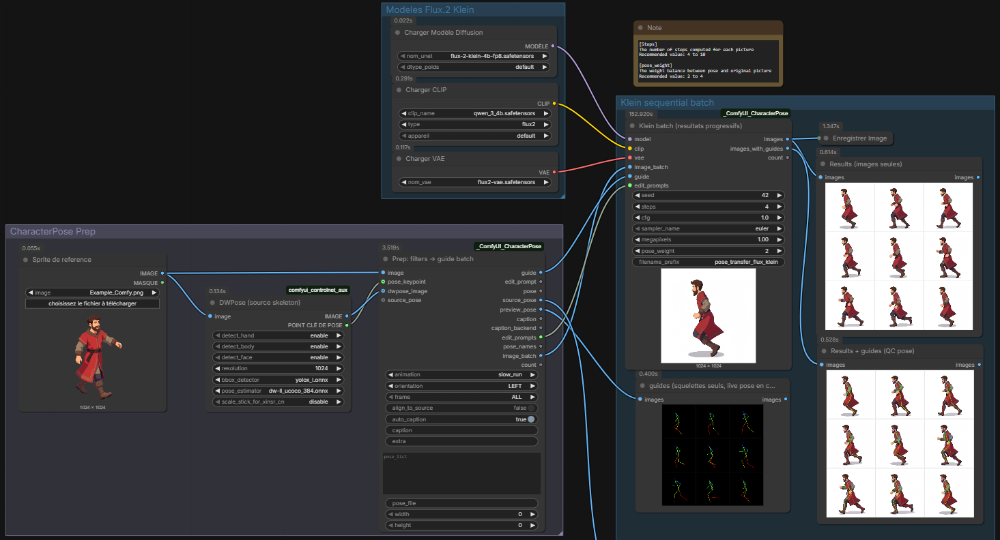

**Flow**

1. **LoadImage** — your character sprite.
2. **DWPreprocessor** (optional) → wire `pose_keypoint` + `dwpose_image` into Prep for a live source stick.
3. **`CP_PoseTransferPrep`** — filter the `poses/` library (`animation` / `orientation` / `frame`, each `ALL` or one value), auto-caption, align sticks to the sprite, emit guide batch + edit prompts.
4. **`CP_KleinPoseBatch`** — one Klein sample per pose (progressive previews as frames finish).
5. **SaveImage** — full batch at the end.

**Tips**

- Distilled Klein: ~4 steps, CFG `1`.
- Prep **`align_to_source`** (default on) scales library sticks to the sprite and keeps them inside the canvas.
- Use Prep **`extra`** for free-form prompt hints (e.g. `holding a sword`).
- Klein has **no OpenPose ControlNet** on this path — pose guidance is soft (reference latent + prompt).

---

## Use — Mixamo utilities

Open:

`workflows/workflow_mixamo.json`

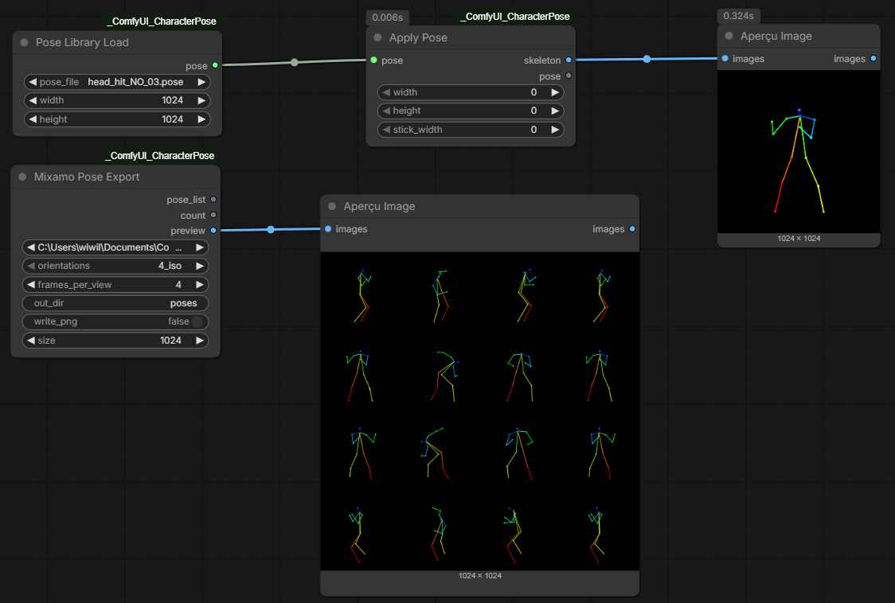

**Flow**

1. Drop Mixamo `.fbx` files into `ComfyUI/input/` or `ComfyUI/input/mixamo/`.
2. **`CP_MixamoPoseExport`** — pick the FBX, set `orientations` (`4_iso` / `6` / `8`) and `frames_per_view` (e.g. 10 / 30 / 60).
3. Export writes `{anim}_{VIEW}_{ii}.pose` into the package `poses/` folder and returns a `pose_list`.
4. **`CP_PoseLibraryLoad`** + **`CP_ApplyPose`** — preview any `.pose` as an OpenPose guide image.

---

## Build the `.pose` library (two ways)

Same exporter under the hood — pick Comfy or CLI.

### Way 1 — ComfyUI node (`CP_MixamoPoseExport`)

1. Install **pufbx** (see [Install](#2-python-dependencies)).
2. Put Mixamo FBX under `ComfyUI/input/` (or `input/mixamo/`).
3. Add **Mixamo Pose Export**, choose:
   - **`orientations`**: `4_iso` · `6` · `8` (or `4_cardinal`)
   - **`frames_per_view`**: e.g. `10` / `30` / `60`
   - **`out_dir`**: `poses` (default — package library)
   - **`write_png`**: optional debug stick PNGs
4. Queue the prompt → `.pose` files land in `poses/`; wire `pose_list` into Prep if you want.

### Way 2 — Python CLI (`mixamo_tools`)

#### Global Python

```bash
cd ComfyUI/custom_nodes/_ComfyUI_CharacterPose
python -m pip install -r mixamo_tools/requirements.txt

# Export every FBX in mixamo/ → poses/ (8 views × 30 samples)
python -m mixamo_tools.export_views --positions 30 --view 8 --out-dir poses
```

#### Dedicated `.venv` (recommended for Windows)

**Windows (PowerShell)**

```powershell
cd ComfyUI\custom_nodes\_ComfyUI_CharacterPose\mixamo_tools
.\setup_env.ps1
# Creates .\venv and installs numpy, Pillow, pufbx

.\venv\Scripts\python.exe -m export_views --positions 30 --view 8 --out-dir ..\poses
```

**Linux / macOS**

```bash
cd ComfyUI/custom_nodes/_ComfyUI_CharacterPose/mixamo_tools
python -m venv venv
source venv/bin/activate
pip install -r requirements.txt

python -m export_views --positions 30 --view 8 --out-dir ../poses
```

#### Useful commands

```bash
# All FBX in the default mixamo/ folder, 4 isometric views, 10 samples
python -m mixamo_tools.export_views --positions 10 --view 4_iso --out-dir poses

# One file only
python -m mixamo_tools.export_views --fbx mixamo/"Slow Run.fbx" --positions 60 --view 8 --out-dir poses

# .pose only (no debug PNG)
python -m mixamo_tools.export_views --positions 30 --view 8 --no-png --out-dir poses
```

#### CLI flags

| Flag | Default | Meaning |
|------|---------|---------|
| `--fbx` | `mixamo/` | One `.fbx` **or** a directory of FBX |
| `--positions N` | `4` | Evenly spaced samples over the clip (`frames_per_view` in the node) |
| `--view` | `ALL` | `SE`…`BOT`, or `4_iso` / `4_cardinal` / `6` / `8` / `ALL` |
| `--frame` | — | Single frame index (overrides `--positions`) |
| `--out-dir` | `mixamo_tools/out` | Use `poses` for the Comfy library |
| `--size` | `1024` | Square canvas |
| `--no-png` | off | Skip debug PNG |
| `--no-pose` | off | Skip `.pose` JSON |

More detail: [`mixamo_tools/README.md`](mixamo_tools/README.md).

---

## Nodes

| Node | Role |
|------|------|
| `CP_MixamoPoseExport` | Mixamo / FBX → `.pose` library + `pose_list` |
| `CP_PoseTransferPrep` | Filters + caption + align → guide batch + prompts |
| `CP_KleinPoseBatch` | Sequential Klein sample per Prep item |
| `CP_PoseLibraryLoad` | Load one `.pose` file |
| `CP_ApplyPose` | Draw OpenPose skeleton image |

---

## Example workflows

| File | What it shows |
|------|----------------|
| [`workflows/pose_transfer_flux_klein.json`](workflows/pose_transfer_flux_klein.json) | Prep → Klein batch (main path) |
| [`workflows/workflow_mixamo.json`](workflows/workflow_mixamo.json) | FBX export + library preview |

Regenerate both from source:

```bash
python workflows/_build_workflows.py
```

---

## Limitations

- **Same-view bias:** a side / ¾ sprite does not become a true front or back for free — pick matching orientations when you can.
- Without `transformers`, Prep still runs with a K-means **COLOR LOCK** palette (Florence-2 is recommended).
- Klein pose lock is **soft** (no OpenPose ControlNet on this path).

---

## Dev / tests

```bash
python tests/smoke_test.py
```

---

## License

MIT — see [LICENSE](LICENSE).

## Credits

- Pose detection via [comfyui_controlnet_aux](https://github.com/Fannovel16/comfyui_controlnet_aux) / DWPose
- Generative edit via Black Forest Labs **FLUX.2 Klein** in ComfyUI
- Captioning via Microsoft **Florence-2** (optional)
- Animation source: [Mixamo](https://www.mixamo.com/) (Adobe) — Mixamo is a trademark of Adobe Inc.
